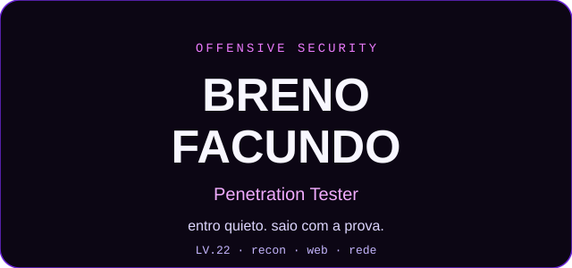
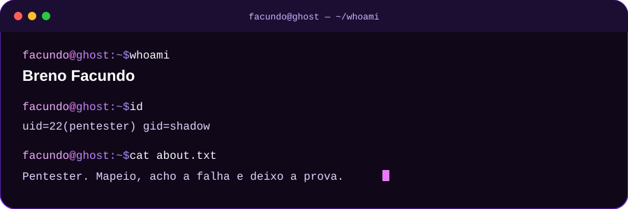
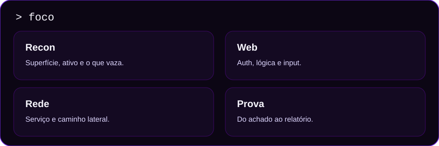

<table width="100%">
  <tr>
    <td width="62%" valign="middle">
      
    </td>
    <td width="38%" align="center" valign="middle">
      
    </td>
  </tr>
</table>

 

 

 

 

 

  
  
  
  
  
  
  
  

 

 

 

